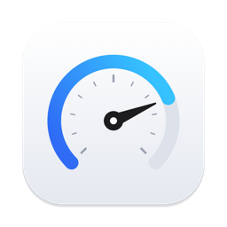
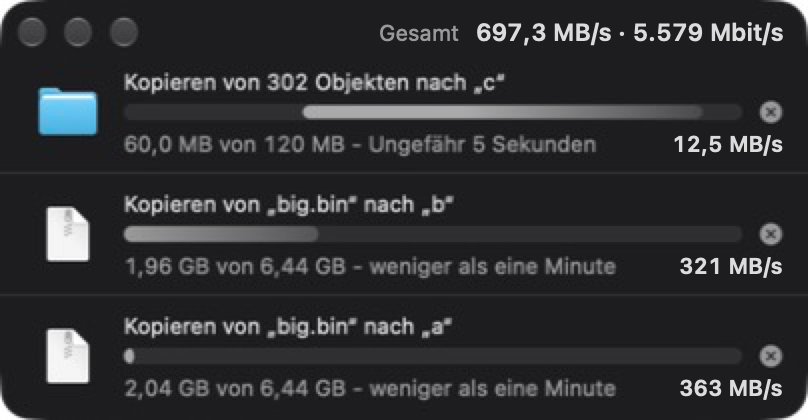

<p align="center">
  
</p>

<h1 align="center">CopySpeed</h1>

<p align="center">
  Zeigt beim Kopieren im Finder die <b>aktuelle Übertragungsgeschwindigkeit</b> direkt im Kopierfenster an –
  in MB/s und Mbit/s, pro Vorgang und als Summe.
</p>

<p align="center">
  
  <br><sub>Drei parallele Kopien (Testdaten): Summe in der Titelzeile, Einzelwerte am Ende der Statuszeilen.</sub>
</p>

---

Das Kopierfenster von macOS zeigt nur die verbleibende Zeit, aber nie, wie schnell gerade kopiert wird.
CopySpeed ergänzt das – ohne den Finder zu verändern.

## Funktionen

### Zwei Darstellungen (Menü → „Anzeige“)

**Im Kopierfenster** (Standard)

- Rechtsbündig in der Titelzeile (dort, wo neben den Ampel-Knöpfen sonst nichts steht):
  - bei **einer** Kopie deren Geschwindigkeit und der Durchschnitt (Ø),
  - bei **mehreren** Kopien die Gesamtsumme („Gesamt …“).
- Bei mehreren Kopien zusätzlich die Geschwindigkeit **am Ende jeder Statuszeile** – kompakt
  („321 MB/s“) und nur, wenn sie neben den Finder-Text passt.
- Wird der Platz in der Titelzeile knapp (z. B. „MB/s und Mbit/s“ bei sehr schnellen SSDs), kürzt sich
  der Text automatisch – bei einer Kopie erst ohne Ø, dann nur noch eine Einheit; bei mehreren Kopien
  erst nur noch eine Einheit, dann ohne „Gesamt“.

**Unter dem Kopierfenster**

- Eine Schublade schaut unter dem Fenster hervor; ihr oberer Rand liegt verdeckt dahinter.
- Zeigt für jede Kopie **Name** und Geschwindigkeit – auch bei einer einzelnen Datei – und nach etwa
  einer Sekunde den Durchschnitt; bei mehreren Kopien zusätzlich die Summe.
- Ist unter dem Fenster kein Platz (Bildschirmrand), schaut sie oben hervor.

### Außerdem

- **Aktuelle Geschwindigkeit** über 3 s geglättet, **Durchschnitt** seit CopySpeed die Kopie erkannt hat
  (läuft CopySpeed bereits, praktisch ab Beginn der Kopie)
- **Gesamtsumme**, wenn mehrere Kopien gleichzeitig laufen
- Einheit wählbar: **MB/s**, **Mbit/s** oder **beides**
- Gesamtgeschwindigkeit live in der **Menüleiste**, solange kopiert wird (abschaltbar)
- Funktioniert mit Netzlaufwerken (SMB), externen Platten und lokalen Kopien
- Erkennt das Kopierfenster sprachunabhängig an seiner Accessibility-Kennung, nicht am Titel. Die
  Größenangaben im Statustext („… von …“ / „… of …“) liest CopySpeed derzeit aber nur bei **deutscher oder
  englischer** Systemsprache – in anderen Sprachen bleibt die Anzeige bei „…“.
- Die Anzeige folgt dem Kopierfenster beim Verschieben, wird bei minimiertem Fenster oder auf einem
  anderen Schreibtisch ausgeblendet und lässt Klicks durch (der Stopp-Knopf bleibt bedienbar)

### Menü in der Menüleiste

| Eintrag | Bedeutung |
|---|---|
| *Statuszeilen* | Laufende Kopien mit Geschwindigkeit, bei mehreren die Summe – oder „Keine Kopie aktiv“ |
| Anzeige | „Im Kopierfenster“ (Standard) oder „Unter dem Kopierfenster“ |
| Einheit | „MB/s“, „Mbit/s“ oder „MB/s und Mbit/s“ (Standard) |
| Geschwindigkeit in der Menüleiste | Statt des Tacho-Symbols die Gesamtgeschwindigkeit zeigen, solange kopiert wird (Standard: an; dort immer nur eine Einheit) |
| Bei Anmeldung starten | CopySpeed beim Anmelden automatisch starten |
| Über CopySpeed | Version und Logo (hell/dunkel passend zum Erscheinungsbild) |
| CopySpeed beenden | App beenden (⌘Q) |

Fehlt der Bedienungshilfen-Zugriff, zeigt die Menüleiste ein Warndreieck und das Menü den Eintrag
„Zugriff erlauben …“.

## Installation

1. `CopySpeed-x.y.z.dmg` aus den [Releases](../../releases) laden und CopySpeed in „Programme“ ziehen.
2. CopySpeed starten. macOS fragt nach dem **Bedienungshilfen-Zugriff** – erlauben
   (*Systemeinstellungen → Datenschutz & Sicherheit → Bedienungshilfen*; je nach macOS-Version kann die
   Liste anders heißen – der Knopf im Systemdialog führt direkt an die richtige Stelle).
3. Fertig. Beim nächsten Kopieren erscheint die Anzeige im Kopierfenster.

**Update:** CopySpeed über das Menü beenden, die neue Version aus der DMG nach „Programme“ ziehen
(ersetzen) und starten. Die Bedienungshilfen-Freigabe bleibt erhalten.

> **Hinweis:** Die aktuellen Builds sind noch nicht mit einer Developer ID notarisiert. Beim ersten Start
> meldet macOS deshalb, dass die App nicht überprüft werden kann. Dann in
> *Systemeinstellungen → Datenschutz & Sicherheit* auf **„Trotzdem öffnen“** klicken.

**Voraussetzung:** macOS 14 Sonoma oder neuer (entwickelt und getestet unter macOS 27).

## Wie es funktioniert

CopySpeed liest das Finder-Kopierfenster (`AXWindow` mit der Kennung `Progress`) alle 0,5 s über die
Accessibility-API aus. Pro Vorgang werden Titel, Fortschrittsbalken (0…1) und Statustext
(„2,00 GB von 3,74 GB – …“) gelesen. Übertragene Bytes = Balkenwert × Gesamtgröße aus dem Statustext;
daraus ergibt sich die Geschwindigkeit.

Den Finder selbst verändert CopySpeed nicht. Die Anzeige ist ein rahmenloses, durchsichtiges `NSPanel`,
das Klicks durchlässt und direkt **über** dem Kopierfenster (bzw. als Schublade direkt **darunter**)
einsortiert wird. Wo genau die Texte stehen, ergibt sich aus den Accessibility-Rahmen der Ampel-Knöpfe,
der Statuszeilen und der tatsächlichen Textbreite (`AXBoundsForRange`). Solange ein Kopierfenster sichtbar
ist, folgt die Anzeige seiner Position 30-mal pro Sekunde; ändert sich die Fenstergröße (Kopie dazu oder
fertig), liest CopySpeed sofort neu aus.

Es werden keine Daten gesammelt oder übertragen, und CopySpeed greift nicht auf Dateiinhalte zu.

## Bekannte Grenzen

- Nur Kopien **im Finder** werden erkannt (nicht `cp`, `rsync` oder andere Programme).
- Geschwindigkeit nur bei deutscher oder englischer Systemsprache (siehe oben).
- Beim schnellen Ziehen des Kopierfensters läuft die Anzeige minimal hinterher.
- Bei Kopien mehrerer Objekte zählt der Finder im Titel die *verbleibenden* Objekte herunter; Schublade
  und Menü übernehmen diese Zahl („302 Objekte“ … „0 Objekte“). Auch am Ende einer Einzelkopie zeigt der
  Finder kurz „Kopieren von 0 Objekten …“.
- Reagiert der Finder nicht mehr, hängt CopySpeed (Menü und Anzeige) mit, bis die Accessibility-Abfragen
  ins Zeitlimit des Systems laufen – ein eigenes, kürzeres Zeitlimit ist noch nicht eingebaut.
- Ändert Apple den Aufbau des Kopierfensters, muss CopySpeed angepasst werden.

## Fehlersuche

Diagnose einschalten (wirkt sofort):

```bash
defaults write com.roman.copyspeed debugLog -bool YES
```

Dann schreibt CopySpeed nach `~/Library/Logs/CopySpeed/`:

- `debug.log` – Rohdaten pro Abfrage: Vorgang (Titel, Ziffern durch `#` ersetzt), Statustext, Balkenwert,
  berechnete Bytes und Geschwindigkeit sowie die Rahmen von Fenster, Balken, Statuszeilen, Ampel-Knöpfen und
  Listenbereich. **Enthält Datei- und Ordnernamen** – vor dem Weitergeben prüfen.
- `overlay-inWindow-<Höhe>.png` bzw. `overlay-drawer-<Höhe>.png` – Schnappschuss der eigenen Anzeige
  (Höhe = Höhe des Kopierfensters, wird alle 0,5 s überschrieben) zum Prüfen der Positionen

Wieder ausschalten: `defaults delete com.roman.copyspeed debugLog`

## Selbst bauen

```bash
brew install xcodegen
xcodegen generate
xcodebuild -project CopySpeed.xcodeproj -scheme CopySpeed build
```

Tests: `xcodebuild -project CopySpeed.xcodeproj -scheme CopySpeed test`

Signiert wird automatisch mit dem Team aus `project.yml` (`DEVELOPMENT_TEAM`). Wer nicht zu diesem Team
gehört, trägt dort sein eigenes Team ein und führt `xcodegen generate` erneut aus. Mit einer festen
Signatur bleibt die Bedienungshilfen-Freigabe über Neubauten hinweg erhalten; bei unsignierten bzw.
ad-hoc-signierten Builds muss sie nach jedem Neubau neu erteilt werden.

**Release bauen** (so entstehen die DMGs in den Releases; benötigt zusätzlich `brew install create-dmg`):
Version in `project.yml` erhöhen (`MARKETING_VERSION`, `CURRENT_PROJECT_VERSION`), dann

```bash
xcodegen generate
xcodebuild -project CopySpeed.xcodeproj -scheme CopySpeed -configuration Release \
  -archivePath build/release/CopySpeed.xcarchive -allowProvisioningUpdates archive
create-dmg --volname CopySpeed --app-drop-link 440 170 --icon CopySpeed.app 160 170 \
  build/release/CopySpeed-x.y.z.dmg <Ordner mit CopySpeed.app aus dem Archiv>
```

## Projektstruktur

| Pfad | Inhalt |
|---|---|
| `CopySpeed/Accessibility` | Auslesen des Finder-Kopierfensters (Vorgänge, Rahmen, Textbreiten) |
| `CopySpeed/Core` | Parser, Geschwindigkeitsberechnung, Formatierung, Layout im Kopierfenster, Einstellungen, Diagnose |
| `CopySpeed/Overlay` | Anzeige im bzw. unter dem Kopierfenster (Panel, Positionierung, Nachführen) |
| `CopySpeed/App` | App-Einstieg und Menüleiste |
| `CopySpeedTests` | Tests für Parser, Geschwindigkeit, Formatierung und Layout |
| `Design` | App-Icon als SVG (hell/dunkel) und Render-Skript |
| `docs` | Bildschirmfoto für diese Seite |
| `Spikes` | Machbarkeitstests aus der Entwicklung |
| `TODO.md` | Plan, Erkenntnisse, Messwerte und offene Punkte |
| `CHANGELOG.md` | Änderungen je Version |

## Lizenz

[MIT](LICENSE) © 2026 Roman Hohenberg
